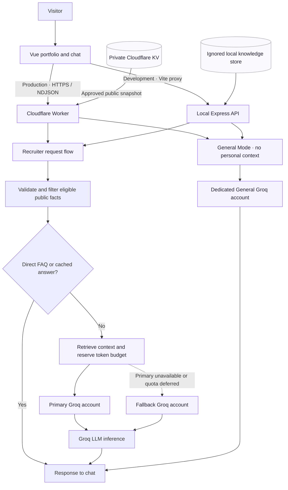

<div align="center">

<sub>SHUBHAM YADAV · FULL STACK DEVELOPMENT</sub>

# Portfolio2026

### The work, the context, and a conversation.

A personal portfolio with **Ask Shubham AI** — a dual-mode assistant for exploring<br />
professional experience, discussing projects, and answering general questions.

<p>
  <a href="https://shubhamyadav7.me/"><strong>Explore the live portfolio ↗</strong></a>
  &nbsp; · &nbsp;
  <a href="#ask-shubham-ai">Meet the assistant</a>
  &nbsp; · &nbsp;
  <a href="#local-setup">Run locally</a>
</p>

<p>
  
  
  
  
</p>

</div>

---

## A portfolio with room for questions

Portfolio2026 brings Shubham Yadav’s work, experience, background, and contact information into one responsive website. Ask Shubham AI adds a conversational way to explore that context, while keeping personal knowledge behind a server-side boundary.

The website presents the work directly. The assistant helps visitors ask follow-up questions, connect documented experience to a role, or switch to a general technical conversation.

## The portfolio

- **Work and experience:** project previews, technology stacks, responsibilities, and selected links.
- **Professional profile:** background, skills, résumé access, and contact options.
- **Responsive navigation:** desktop and mobile layouts with light and dark themes.
- **Considered motion:** section transitions and intersection-driven reveals.
- **Integrated chat:** a floating assistant with mode selection, suggested questions, and separate conversations.

---

## Ask Shubham AI

Two modes share one interface, with distinct knowledge boundaries.

| | Recruiter Mode | General AI Mode |
| :--- | :--- | :--- |
| **Purpose** | Explore documented background, projects, and role fit | Answer technical and general questions |
| **Personal knowledge** | Current, explicitly approved public facts from the backend | No portfolio knowledge supplied |
| **Direct questions** | Existing FAQ answers return locally without inference | Answered through the model |
| **Reasoning** | Explain, compare, and make conditional assessments using approved context | Explain concepts, discuss ideas, and provide relevant code |
| **Missing information** | Acknowledge gaps without inventing personal details | State uncertainty when appropriate |
| **Delivery** | Complete response collected before delivery in streamed chunks | Provider text delivered progressively |
| **Provider routing** | Primary and fallback Groq accounts with separate quota state | Dedicated General Mode Groq account |

Recruiter Mode can also answer general questions without injecting unrelated personal facts. The interface retains a suggestion to use General AI Mode for those conversations.

**Conversation controls:** stop generation, retry a failed turn, clear conversations, and switch modes. Responses support formatted text, code blocks, and safe links; generated HTML is rendered as text rather than executed.

### Grounding without a second AI reviewer

Recruiter Mode uses one generation call by default. It combines the original question, bounded conversation context, and relevant approved facts in a plain-text request. It does not require a JSON answer wrapper or a separate AI Evidence Review call.

Personal claims must stay within the supplied evidence. The prompt distinguishes listed skills from demonstrated work, preserves expected dates and employer relationships, corrects unsupported premises, and handles limitations constructively. These are grounding instructions, not a guarantee that generated text is error-free.

---

## Architecture



The Worker and local Express server are alternative backend entry points. The browser receives answers, not access to the knowledge store. Both Recruiter accounts use the configured Groq model; the current default is `openai/gpt-oss-20b`.

### Privacy and API security

- **Server-side knowledge:** personal JSON, imported drafts, and detailed provenance live outside the tracked application data. Frontend code does not import them.
- **Explicit eligibility:** only verified, public, unchanged, and current facts can enter Recruiter context. Private, pending, and expired records are excluded.
- **Private KV access:** the Worker reads the `approved-knowledge` key through its `KNOWLEDGE` binding. There is no public knowledge-download endpoint.
- **Server-only credentials:** provider keys belong in local backend environment files or Worker secrets, never browser variables or source code.
- **Request boundaries:** input and history limits, allowed-origin checks, request-rate limits, concurrency limits, and response deadlines constrain API work.
- **Protected local files:** Git ignores the private store and environment files; Vite denies direct access to knowledge files and private storage.
- **Local diagnostics:** the Express backend logs request-linked events with credential and contact-data redaction.

### Streaming, quotas, and recovery

The chat protocol uses newline-delimited JSON events for response state and text delivery. Cancellation propagates through the request path, and interrupted responses remain distinguishable from completed answers.

Recruiter Mode scales its completion allowance to request complexity and requested detail, including space for hidden reasoning. Admission reserves the prompt estimate and full completion allowance, then reconciles reservations with reported usage. Independent account meters apply the configured **85% token safety threshold**, provider reset information, and daily or minute cooldowns.

A request can switch to the other eligible Recruiter account when needed. Recovery shares a single bounded loop: at most one additional attempt within the original deadline. Transient empty streams may recover before any response content is produced; partial streams are not regenerated. Cached answers and shared in-flight requests reduce repeated generation.

Quota state and caches are process-local. They do not provide a distributed quota ledger across Worker isolates or backend replicas.

---

## Technology stack

| Layer | Implementation |
| :--- | :--- |
| Interface | Vue 3, Vue Router, JavaScript, Tailwind CSS |
| Tooling | Vite 7, PostCSS |
| Local API | Node.js, Express 5, Groq SDK |
| Production API | Cloudflare Workers, fetch-based provider streaming |
| Knowledge storage | Private Cloudflare KV; ignored local server storage |
| Inference | Groq, with separate Recruiter primary, Recruiter fallback, and General credentials |
| Verification tooling | Node test runner, browser checks, esbuild-based checks, knowledge validation |
| Frontend hosting | GitHub Pages workflow and custom domain |

## Project structure

```text
Portfolio2026/
├── src/
│   ├── components/assistant/   # Chat interface and message rendering
│   ├── composables/           # Conversation state and UI behavior
│   ├── services/assistant/    # Client transport and response utilities
│   ├── views/                 # Portfolio sections
│   └── portfolio.js           # Public website content
├── server/
│   ├── app.js                 # Local HTTP API
│   ├── policy.js              # Routing, retrieval, and prompts
│   ├── recruiter.js           # Recruiter generation and recovery
│   ├── groqMetrics.js         # Quota accounting and cooldowns
│   └── private/               # Local-only knowledge; ignored by Git
├── worker/index.js            # Production API and private KV access
├── knowledge/                 # Loader, schema, validation, and storage guide
├── scripts/                   # Knowledge maintenance and public-only export
├── tests/                     # Frontend and knowledge checks
├── .github/workflows/         # GitHub Pages deployment
└── wrangler.toml              # Worker configuration and binding declaration
```

---

## Local setup

Use **Node.js 22.12 or newer** and npm.

**1. Install the frontend and local backend dependencies.**

```sh
npm ci
npm ci --prefix server
```

**2. Configure the local API.** Copy the example only if `server/.env` does not already exist:

```sh
cp -n server/.env.example server/.env
```

Set these server-only variables in `server/.env`:

| Variable | Purpose |
| :--- | :--- |
| `GROQ_RECRUITER_API_KEY` | Recruiter primary account |
| `GROQ_FALLBACK_API_KEY` | Separate Recruiter fallback account |
| `GROQ_GENERAL_API_KEY` | General Mode account |
| `GROQ_MODEL` | Groq model selection |
| `PERSONAL_KNOWLEDGE_DIR` | Optional protected knowledge directory override |

The owner's knowledge store is intentionally absent from a clean clone. Provision it separately at `server/private/knowledge/`, or point `PERSONAL_KNOWLEDGE_DIR` to a protected directory. General Mode does not require personal knowledge. Storage details are in [knowledge/README.md](knowledge/README.md).

**3. Start the API and frontend in separate terminals.**

```sh
# Terminal 1 — local API
npm run dev:server
```

```sh
# Terminal 2 — portfolio
npm run dev
```

Open `http://localhost:5173`. Vite proxies `/api` to the local backend on port `3001`; private knowledge stays on the server.

---

## Deployment

The frontend and Worker deploy separately. Frontend builds do not require the private knowledge store.

### Portfolio · GitHub Pages

```sh
npm run build
```

The output is `dist/`. The existing GitHub Actions workflow builds and publishes that directory when changes are pushed to `main`. Keep hosting and custom-domain settings aligned with your own deployment.

### Ask Shubham AI · Cloudflare Worker

Before deploying, manually provision the following in the intended Cloudflare account:

1. A private KV namespace bound as **`KNOWLEDGE`** in `wrangler.toml`. Use your own namespace ID.
2. Worker secrets named **`GROQ_RECRUITER_API_KEY`**, **`GROQ_FALLBACK_API_KEY`**, and **`GROQ_GENERAL_API_KEY`**.
3. The approved public snapshot under KV key **`approved-knowledge`**. Use the public-only exporter; do not upload the full private store.
4. The correct production origin in **`ALLOWED_ORIGINS`**, and a frontend chat endpoint pointing to your Worker. Production endpoint selection is in `src/services/assistant/streamResponder.js`.

The [knowledge storage guide](knowledge/README.md) explains snapshot generation and privacy boundaries. Re-export and update KV when approved knowledge changes; local data edits do not update production automatically.

Once those prerequisites are complete, deployment is an explicit operator action:

```sh
npx wrangler deploy
```

Keep private data and credentials out of commits, build artifacts, and public download routes. Ignore rules prevent ordinary additions; they do not erase data from earlier Git history.

---

<div align="center">

**Portfolio2026 · Ask Shubham AI**<br />
<sub>Work presented clearly. Context shared deliberately.</sub>

[Visit the portfolio](https://shubhamyadav7.me/)

</div>
